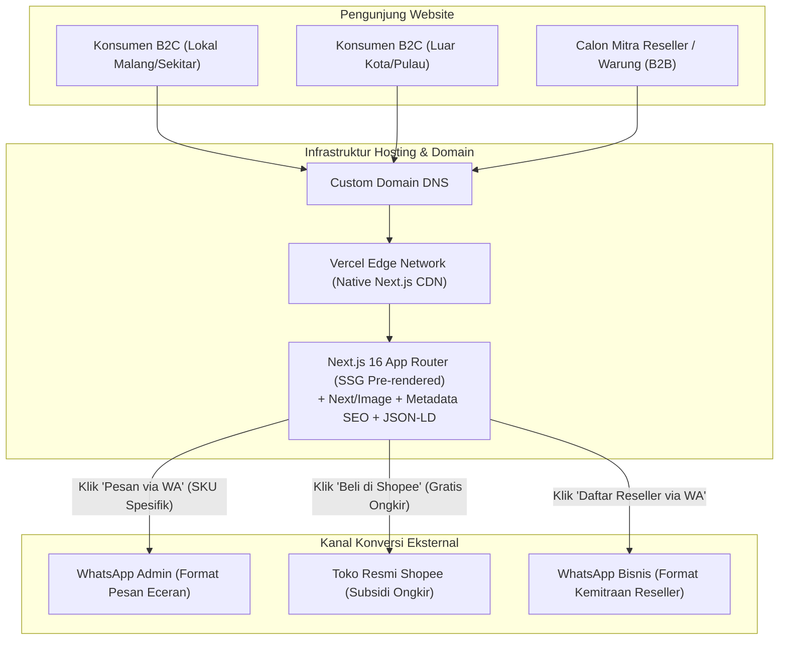
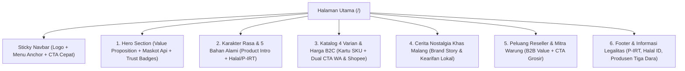

# High-Level Design (HLD)
## Website Landing Page — Kacang Pedes Singo

| Informasi Dokumen | Detail |
| :--- | :--- |
| **Nama Proyek** | Website Landing Page Kacang Pedes Singo (MVP) |
| **Dokumen Referensi** | [brd_kacang_pedes_singo.md](file:///d:/Code/my-project/singo/docs/brd_kacang_pedes_singo.md) (v1.1) |
| **Jenis Dokumen** | High-Level Design (HLD) — Fokus Solusi, Arsitektur & Desain (*How*) |
| **Tech Stack Utama** | **Next.js 16 (App Router)**, React 19, TypeScript, Tailwind CSS, Vercel |
| **Versi & Status** | v1.1 — Final Baseline (Diperbarui dengan Arsitektur Next.js 16 & Placeholder 4 Varian) |
| **Tanggal** | 8 November 2026 |

---

## 1. Gambaran Umum Arsitektur Solusi (System Overview)

Dokumen High-Level Design (HLD) ini menerjemahkan kebutuhan bisnis dari **BRD Kacang Pedes Singo** ke dalam rancangan arsitektur sistem, struktur halaman (*Information Architecture*), spesifikasi komponen antarmuka (*UI Blueprint*), sistem desain visual (*Warm Authentic Snack*), serta strategi penempatan aset maskot dan logo.

### 1.1 Prinsip Arsitektur Utama
1. **Zero-Backend Static Architecture (Memenuhi `REQ-B08`):** Seluruh halaman disajikan sebagai aset statis (*pre-rendered HTML/CSS/JS*) melalui jaringan CDN global Vercel. Tidak ada *database* atau server aplikasi yang perlu dipelihara secara berkala.
2. **Mobile-First Responsive Design:** Lebih dari 80% trafik konsumen camilan berasal dari perangkat seluler. Tata letak dirancang mulai dari layar vertikal (*viewport* `360px–430px`) sebelum diperluas ke layar desktop (`1280px+`).
3. **Dual-Funnel Deep Linking (Memenuhi `REQ-B04`, `REQ-B05`, `REQ-B06`):** Konversi tidak menggunakan *checkout* internal, melainkan menggunakan *URL Deep Linking* ke **WhatsApp API (`wa.me`)** dengan parameter teks dinamis dan tautan langsung ke **Shopee Official Store**.

### 1.2 Diagram Konteks Arsitektur Sistem



### 1.3 Spesifikasi Tech Stack & Keunggulan Arsitektur SEO (Next.js 16)

Untuk memenuhi kebutuhan bisnis **`REQ-B08` (Kemudahan Operasional)** dan **`REQ-B09` (Optimasi Mesin Pencari / SEO)**, sistem dibangun menggunakan **Next.js 16 (App Router)**:

| Lapisan Teknologi | Spesifikasi Teknologi | Peran Arsitektural & Keunggulan SEO |
| :--- | :--- | :--- |
| **Core Framework** | **Next.js 16 (App Router)** + React 19 | *Server Components* & *Static Site Generation (SSG)* menghasilkan HTML utuh saat *build* sehingga *crawler* Google langsung membaca seluruh konten secara instan. |
| **Language & Typing** | **TypeScript** | Menjamin konsistensi skema data 4 varian produk, harga, dan *template* tautan WhatsApp. |
| **Styling System** | **Tailwind CSS** | Konfigurasi *custom theme tokens* sesuai palet *Warm Authentic Snack* dengan ukuran bundel CSS yang sangat ringan. |
| **SEO & Metadata Engine** | **Next.js Metadata API** (`app/layout.tsx`, `app/sitemap.ts`, `app/robots.ts`) | Pengelolaan terpusat untuk *Title*, *Meta Description*, *OpenGraph* (pratinjau link WhatsApp), `sitemap.xml`, `robots.txt`, serta *JSON-LD Structured Data* (`Product` & `LocalBusiness`). |
| **Image Optimization** | **`next/image` (`<Image />`)** | Konversi otomatis aset gambar ke format `WebP`/`AVIF`, pengaturan ukuran responsif per *device*, dan pencegahan pergeseran tata letak (*Cumulative Layout Shift* `CLS = 0`). |
| **Deployment & CDN** | **Vercel** + Custom Domain | Integrasi *native* dengan Next.js 16 (zero-configuration), distribusi CDN global, dan SSL/HTTPS otomatis. |

### 1.4 Arsitektur Direktori Proyek (High-Level Folder Structure)

```text
singo/
├── docs/                                  # Dokumentasi BRD & HLD
├── reference/
│   ├── cap_besar.png & cap_kecil.png      # Sumber label kemasan asli
│   └── web_assets/                        # Master aset bersih & placeholder produk
├── public/
│   └── images/
│       ├── brand/                         # logo_singo_clean.png & variasi maskot
│       └── products/                      # Gambar 4 varian (default: placeholder_*.png)
└── src/
    ├── app/
    │   ├── layout.tsx                     # Root Layout + Next.js 16 Metadata API & JSON-LD
    │   ├── page.tsx                       # Halaman Utama (6 Section Landing Page)
    │   ├── sitemap.ts                     # Generator otomatis sitemap.xml
    │   └── robots.ts                      # Generator otomatis robots.txt
    ├── components/
    │   ├── layout/                        # Navbar.tsx, Footer.tsx
    │   └── sections/                      # Hero, TasteIngredients, ProductCatalog, Story, Reseller
    └── data/
        └── products.ts                    # Data statis 4 SKU, harga, & path gambar produk
```

---

## 2. Arsitektur Informasi & Alur Pengguna (Information Architecture)

### 2.1 Struktur Navigasi & Sitemap (Single-Page Architecture)
Karena proyek berfokus pada satu lini produk utama (**Kacang Pedes Singo** dengan 4 varian ukuran), arsitektur informasi menggunakan pola **Single-Page Storytelling & Conversion Flow** dengan *smooth anchor navigation*:



### 2.2 Pemetaan Section terhadap Kebutuhan Bisnis (BRD Traceability Matrix)

| Urutan Section | Nama Section UI | Kebutuhan Bisnis (BRD) yang Dipenuhi | Tujuan Konversi / Komunikasi |
| :--- | :--- | :--- | :--- |
| **Header** | `Navbar` | `REQ-B01`, `REQ-B04` | Memudahkan lompatan antar-section ke Katalog atau Reseller kapan saja. |
| **Section 1** | `Hero Section` | `REQ-B01`, `REQ-B02`, `REQ-B07` | Menarik perhatian dalam 5 detik pertama: rasa pedas-asam-manis khas Malang + Halal & P-IRT. |
| **Section 2** | `Taste & Natural Ingredients` | `REQ-B02`, `REQ-B07`, `BR-02` | Menjelaskan sensasi level *Hot* dan keaslian 5 komposisi alami (*Kacang, Gula, Asam, Cabai, Garam*). |
| **Section 3** | `Product Variants & Pricing` | `REQ-B03`, `REQ-B04`, `REQ-B05`, `BR-01`, `BR-03` | Menampilkan 4 varian kemasan, berat, harga retail Rp 10k/20k, serta tombol WA & Shopee. |
| **Section 4** | `Malang Heritage Story` | `REQ-B01`, `BR-05` | Membangun ikatan emosional jajanan lawas Malang yang higienis dan autentik. |
| **Section 5** | `B2B Reseller Opportunity` | `REQ-B06`, `BR-01`, `BR-04` | Mengakuisisi mitra warung/toko dengan penawaran harga khusus grosir via WhatsApp. |
| **Footer** | `Compliance & Contact Footer` | `REQ-B02`, `BR-02`, `BR-05` | Menampilkan nomor P-IRT, nomor sertifikat Halal Indonesia, dan atribusi produsen Tiga Dara. |

---

## 3. Spesifikasi High-Level Komponen per Section (UI Blueprint)

### 3.1 Sticky Navbar
* **Kiri:** Logo horizontal **SINGO Kacang Pedes** (`logo_singo_clean.png`).
* **Tengah (Desktop) / Drawer (Mobile):** Tautan jangkar (*anchor links*): `Keunggulan`, `Varian & Harga`, `Cerita Kami`, `Peluang Reseller`.
* **Kanan:** Tombol ringkas `Pesan Sekarang` yang menggulir halus (*scroll*) ke Section Katalog Varian.

### 3.2 Section 1: Hero Section
* **Tata Letak:** 2 kolom pada Desktop (Kiri: Teks & CTA, Kanan: Komposisi Visual Produk + Maskot), 1 kolom bertumpuk pada Mobile.
* **Elemen Konten Kiri:**
  - *Pill Badge:* `🌶️ Camilan Khas Malang`
  - *Headline Utama:* **"Renyah Kacangnya, Pedasnya Bikin Kangen!"**
  - *Sub-headline:* Kacang tanah goreng renyah dengan bumbu cabai, gula, dan asam jawa yang medok. Camilan pas buat teman santai, kerja, atau ngumpul bareng keluarga.
  - *Dual CTA Bar:*
    - Tombol Primer: `Lihat Pilihan Kemasan` (Warna *Warm Terracotta* `#B84227`).
    - Tombol Sekunder: `Info Reseller` (Gaya *Outline Warm*).
* **Elemen Visual Kanan:**
  - Visual kemasan utama (`cap_besar.png` / mockup kemasan) didampingi **Maskot Kacang Berapi** (`maskot_kacang_api_clean.png`).

### 3.3 Section 2: Karakter Rasa & 5 Bahan Alami
* **Tata Letak:** *Architectural Packaging Ledger* 3 Kolom Karakter Rasa + Blok Komposisi 5 Bahan Dapur Asli bergaris tinta tegas (`1.5px solid #36251A`).
* **3 Pilar Rasa (Dengan Ikon Vektor SVG Kustom, Tanpa Emoji OS):**
  1. **Pedasnya Berasa Banget:** Pakai cabai merah asli yang pedasnya langsung terasa di lidah, bikin melek dan pengen nambah terus.
  2. **Bumbu Manis-Asam yang Medok:** Takaran gula dan asam jawanya pas, menyatu jadi bumbu karamel yang lengket, gurih, dan segar.
  3. **Kacangnya Garing & Tanpa Pengawet:** Digoreng sampai renyah ke dalam, nggak bau tengik, dan awet garingnya meski tanpa bahan pengawet.
* **Baris Komposisi Dapur Asli (Custom Vector SVG):** Menampilkan 5 sel bahan dengan ilustrasi SVG kustom bergaris tinta: `Kacang Tanah`, `Cabai`, `Gula`, `Asam Jawa`, dan `Garam`.
* **Aksen Maskot:** Menggunakan variasi terpilih **`maskot_taste_chefs_kiss.png` (Opsi A2)** yang menampilkan gestur *"Oke / Chef's Kiss"* dengan satu tangan memegang cabai merah segar dan hembusan api kecil di samping mulut.

### 3.4 Section 3: Katalog 4 Varian Produk & Dual-CTA (Inti Konversi B2C)
* **Tata Letak:** Grid 2x2 bersih pada Desktop/Tablet (tanpa tertutupi maskot agar fokus penuh pada ke-4 produk), 1 kolom vertikal pada Mobile.
* **Komponen Kartu Produk (Product Card):**
  Setiap kartu memuat:
  - Visual Kemasan / Placeholder (`Cap Kecil` untuk Pack Kecil & Sedang, `Cap Besar` untuk Jumbo).
  - Tag Segmen (*"Cocok buat Eceran Warung"*, *"Pas Buat Stok Harian"*, *"Paling Laris"*, *"Praktis Sekali Buka"*).
  - Nama Varian dan Tabel Spesifikasi Fisik terstruktur (*Isi Kemasan* & *Berat Bersih*: `120g`, `240g`, `115g`).
  - Harga Retail B2C ditampilkan tegas (`Rp 10.000` atau `Rp 20.000`).
  - **Dual Action Buttons (Dengan Ikon SVG):**
    1. **Tombol WhatsApp (`#1F5F3A` Heritage Green):** Membuka chat WA otomatis dengan nama varian yang dipilih.
    2. **Tombol Shopee (`#D67D28` Roasted Amber):** Membuka toko Shopee untuk pembeli luar kota yang mengincar voucher gratis ongkir.
* **Catatan Kaki Katalog (Memenuhi `BR-03`):**
  > *"Info Pengiriman: Buat area Malang Raya, Lawang, Sidoarjo, dan sekitarnya bisa pesan langsung lewat WhatsApp. Kalau kamu di luar kota, bisa beli lewat Shopee supaya dapat Voucher Gratis Ongkir (harga di Shopee menyesuaikan biaya layanan aplikasi)."*

### 3.5 Section 4: Cerita Singkat Khas Malang (Brand Story) + Maskot Peeking `C1`
* **Tata Letak:** Bingkai Editorial Asimetris 2 Kolom (5 kolom judul + kotak stempel produksi Tiga Dara di kiri, 7 kolom narasi + 3 baris momen konsumsi di kanan).
* **Aksen Interaktif Maskot UI (`Opsi C1` — `maskot_catalog_peeking.png`):** Ditempatkan mengintip tepat di atas garis batas atas (`border-top`) bingkai cerita di sisi kanan atas (`top: -1px; transform: translateY(-84.5%)`), sehingga bagian bawah badan kacang menapak rata di atas garis tepi sementara kedua jari sarung tangan putihnya menjuntai ke depan menggenggam bingkai.
* **Narasi:** Mengangkat cerita kacang goreng berbumbu pedas, manis, dan asam yang sudah lama jadi camilan favorit di Malang dan sekitarnya, diolah secara rumahan dengan bersih dan bumbu yang tetap medok.

### 3.6 Section 5: Peluang Kemitraan Reseller & Grosir (Inti Konversi B2B)
* **Tata Letak:** *High-Impact Banner Card* dengan bingkai aksen hangat dan visual **Maskot Akrab/Mitra** **`maskot_reseller_wink.png` (Opsi B2)** yang mengedipkan mata ramah sambil melambai menyapa calon mitra.
* **Poin Nilai Jual B2B:**
  - Harga jual eceran Rp 10.000 yang sangat cepat laku di warung, toko oleh-oleh, maupun kantin.
  - Tersedia varian renteng/pack (isi 5 dan isi 10) yang siap pajang.
  - Harga khusus *reseller* dengan minimal pembelian yang ramah bagi pemula.
* **CTA Khusus B2B:** Tombol `Tanya Harga Reseller via WhatsApp` dengan format pesan otomatis khusus mitra bisnis.

### 3.7 Section 6: Footer & Kepatuhan Legalitas
* Menampilkan logo **SINGO Kacang Pedes**, ringkasan kontak, tautan cepat, serta blok legalitas resmi:
  - **P-IRT:** `2113514011294-28`
  - **Sertifikat Halal Indonesia:** `ID35110014460411223`
  - **Diproduksi Oleh:** Tiga Dara, Purwodadi - Jawa Timur.

---

## 4. Sistem Desain Visual ("Warm Authentic Snack")

Sesuai arahan *brand* yang menginginkan nuansa **hangat (*warm*), mengundang selera, nyaman di mata, dan tidak nyentrik**, berikut adalah spesifikasi *Design Tokens* yang dikunci pada HLD:

### 4.1 Palet Warna (Color Tokens)

| Token CSS | Nama Warna | Kode Hex | Peran pada Antarmuka Web |
| :--- | :--- | :--- | :--- |
| `--bg-warm-cream` | **Warm Rice Cream** | `#FDF9F3` | Warna latar belakang utama halaman (hangat, tidak menyilaukan mata). |
| `--bg-warm-sand` | **Soft Toasted Sand** | `#F5ECE0` | Latar belakang sekunder untuk memisahkan antar-section. |
| `--surface-card` | **Pure Warm White** | `#FFFFFF` | Permukaan kartu produk dan kontainer informasi. |
| `--primary-terracotta` | **Warm Chili Terracotta** | `#B84227` | Warna aksi utama (CTA Primer, Harga Produk, Badge Penting). |
| `--accent-amber` | **Roasted Peanut Amber** | `#D67D28` | Warna aksen hangat (Tombol Shopee, Highlight Reseller, Ikon Bintang). |
| `--brand-green` | **Heritage Singo Green** | `#1F5F3A` | Warna identitas logo "SINGO", Badge Halal/P-IRT, dan Tombol WhatsApp. |
| `--text-espresso` | **Dark Roasted Brown** | `#36251A` | Warna teks judul dan paragraf utama (lembut dibanding hitam pekat). |
| `--text-muted` | **Warm Umber Grey** | `#7A695E` | Warna teks pendukung, label berat kemasan, dan keterangan tambahan. |
| `--border-warm` | **Almond Border** | `#EADBCC` | Garis tepi halus pada kartu produk dan pembatas section. |

### 4.2 Sistem Tipografi (Typography Scale)
* **Font Judul (Heading / Display):** `Plus Jakarta Sans` atau `Bricolage Grotesque` (Bold / ExtraBold `700–800`). Memberikan kesan modern, tegas, ramah, dan sangat mudah dibaca.
* **Font Teks Isi (Body / UI):** `Plus Jakarta Sans` atau `DM Sans` (Regular `400`, Medium `500`, SemiBold `600`).
* **Skala Ukuran (Responsive Clamp):**
  - `H1 (Hero Title)`: `2.25rem` (Mobile) hingga `3.25rem` (Desktop), *line-height* `1.15`.
  - `H2 (Section Title)`: `1.75rem` (Mobile) hingga `2.25rem` (Desktop), *line-height* `1.2`.
  - `H3 (Card Title)`: `1.125rem` – `1.25rem`, *font-weight* `700`.
  - `Body Text`: `1rem` (`16px`), *line-height* `1.6`.
  - `Caption / Badge`: `0.75rem` – `0.875rem` (`12px–14px`), minimum absolut `12px`.

---

## 5. Arsitektur & Strategi Penempatan Aset Visual (Logo & Maskot)

### 5.1 Aturan Anatomi & DNA Visual Maskot (Character Design Rules)
Seluruh variasi maskot Kacang Pedes Singo mematuhi aturan anatomi karakter klasik (*Rubber-Hose / Bold Cartoon*) agar 100% konsisten dengan desain pada cap kemasan asli:
1. **Mulut Blok Hitam Pekat (*Solid Black Void `#000000`*):** Bentuk mulut (baik oval kaget maupun senyum huruf `D`) wajib menggunakan warna hitam solid tanpa deretan gigi putih dan tanpa lidah berwarna pink.
2. **Mata Dempet & Pupil *Pie-Cut*:** Dua mata putih besar yang menyatu di tengah dengan pupil hitam berpotongan segitiga (*pie-cut*) dan alis hitam tebal melayang. Emosi karakter dikendalikan oleh kelopak mata, kedipan (*wink*), dan arah lirikan pupil.
3. **Lengan *Rubber-Hose* & Sarung Tangan Putih 4 Jari:** Lengan hitam melengkung luwes dengan sarung tangan putih bergaris *outline* hitam tebal yang berinteraksi secara hidup (gestur *Chef's Kiss*, melambai, atau mencengkeram tepi kartu UI).

### 5.2 Daftar Aset Final di `reference/web_assets/` & Pemetaan Penempatan

| Nama File Aset (`reference/web_assets/`) | Kategori Aset | Lokasi Penempatan di Web | Peran Visual & UX |
| :--- | :--- | :--- | :--- |
| `logo_singo_clean.png` | Ekstraksi Asli (Transparan) | Navbar, Hero Stage & Footer | Identitas utama brand "SINGO Kacang Pedes" asli dengan latar transparan bersih. |
| `maskot_kacang_api_clean.png` | Cut-out Asli (Dibersihkan) | Hero Section Utama | Menunjukkan ekspresi kepedasan maksimal dengan kobaran api & cabai *"HOT"* asli. |
| `maskot_kacang_hot_clean.png` | Cut-out Asli (Dibersihkan) | Callout Pendukung Pedas / OG Image | Menampilkan maskot + cabai *"HOT"* asli tanpa latar api besar. |
| `maskot_kacang_clean.png` | Cut-out Asli (Dibersihkan) | Aset Dasar / Favicon | Karakter dasar maskot asli bebas latar dan bebas artefak garis. |
| `maskot_taste_chefs_kiss.png` | **Variasi Terpilih A2** | Section 2: Karakter Rasa & 5 Bahan Alami | Kelopak mata puas + gestur tangan *"Oke / Chef's Kiss"* & tangan kiri memegang cabai merah utuh + hembusan api kecil. |
| `maskot_catalog_peeking.png` | **Variasi Terpilih C1** | Section 4: Cerita Khas Malang (Peeking di Atas Bingkai) | Maskot mengintip dari balik tepi atas bingkai cerita dengan kedua sarung tangan putih mencengkeram pinggiran atas bingkai (`transform: translateY(-84.5%)`). |
| `maskot_reseller_wink.png` | **Variasi Terpilih B2** | Section 5: Peluang Reseller (B2B) | Mata mengedip akrab (*wink*) + senyum hitam solid + tangan melambai ramah menyapa calon mitra usaha. |

### 5.3 Strategi Placeholder Gambar 4 Varian Produk (Memenuhi `BR-06` & `REQ-B03`)

Sambil menunggu foto fisik kemasan selesai difoto, sistem menyediakan **4 file *placeholder* visual default** berdimensi `800x800px` (rasio `1:1`) yang sudah memuat pratinjau cap resmi (`Cap Kecil` / `Cap Besar`) beserta informasi spesifik tiap varian:

| Kode SKU | Nama File Placeholder (`reference/web_assets/`) | Path Publik Next.js (`public/images/products/`) | Spesifikasi Visual Placeholder |
| :--- | :--- | :--- | :--- |
| **SKU-01** | [placeholder_pack_kecil_10.png](file:///d:/Code/my-project/singo/reference/web_assets/placeholder_pack_kecil_10.png) | `/images/products/placeholder_pack_kecil_10.png` | Kartu *Warm Cream* dengan pratinjau `Cap Kecil Horizontal` + label *"PACK KECIL (ISI 10) • 120g • Rp 10.000"*. |
| **SKU-02** | [placeholder_pack_sedang_5.png](file:///d:/Code/my-project/singo/reference/web_assets/placeholder_pack_sedang_5.png) | `/images/products/placeholder_pack_sedang_5.png` | Kartu *Warm Cream* dengan pratinjau `Cap Kecil Horizontal` + label *"PACK SEDANG (ISI 5) • 120g • Rp 10.000"*. |
| **SKU-03** | [placeholder_pack_sedang_10.png](file:///d:/Code/my-project/singo/reference/web_assets/placeholder_pack_sedang_10.png) | `/images/products/placeholder_pack_sedang_10.png` | Kartu *Warm Cream* dengan pratinjau `Cap Kecil Horizontal` + label *"PACK SEDANG (ISI 10) • 240g • Rp 20.000"*. |
| **SKU-04** | [placeholder_jumbo_115g.png](file:///d:/Code/my-project/singo/reference/web_assets/placeholder_jumbo_115g.png) | `/images/products/placeholder_jumbo_115g.png` | Kartu *Warm Cream* dengan pratinjau `Cap Besar Vertikal` + label *"KEMASAN JUMBO (1 PC) • 115g • Rp 10.000"*. |

> [!TIP]
> **Prosedur Penggantian Foto Produk Asli Nanti:**
> Saat foto produk asli sudah tersedia, cukup timpa file di `public/images/products/` atau ubah properti `image` di `src/data/products.ts` tanpa perlu mengubah satu baris pun kode komponen UI Next.js.

---

## 6. Skema Data Katalog & Format Integrasi Eksternal

### 6.1 Skema Data Statis Produk (`src/data/products.ts`)
Data keempat varian produk disimpan dalam struktur konfigurasi statis TypeScript/JSON lengkap dengan atribut gambar *placeholder* dan teks alternatif (`imageAlt`) untuk SEO gambar Google:

```json
[
  {
    "id": "pack-kecil-10",
    "sku": "SKU-01",
    "name": "Pack Kecil (Isi 10 Bungkus)",
    "packCount": "10 pcs / pack",
    "netWeightGrams": 120,
    "priceIDR": 10000,
    "capType": "cap_kecil",
    "image": "/images/products/placeholder_pack_kecil_10.png",
    "imageAlt": "Kacang Pedes Singo Khas Malang - Kemasan Pack Kecil Isi 10 Bungkus (120 gram)",
    " isPlaceholder": true,
    "badge": "Cocok untuk Jual Eceran",
    "description": "Ukuran praktis isi 10 bungkus kecil. Sangat pas untuk camilan harian maupun dijual eceran di warung.",
    "waMessageTemplate": "Halo Admin Kacang Pedes Singo, saya ingin memesan *Pack Kecil (Isi 10 - 120gr)* seharga Rp 10.000 sebanyak [... pack]. Mohon info total & ongkir ke [Kecamatan/Kota]."
  },
  {
    "id": "pack-sedang-5",
    "sku": "SKU-02",
    "name": "Pack Sedang (Isi 5 Bungkus)",
    "packCount": "5 pcs / pack",
    "netWeightGrams": 120,
    "priceIDR": 10000,
    "capType": "cap_kecil",
    "image": "/images/products/placeholder_pack_sedang_5.png",
    "imageAlt": "Kacang Pedes Singo Khas Malang - Kemasan Pack Sedang Isi 5 Bungkus (120 gram)",
    "isPlaceholder": true,
    "badge": "Porsi Pas Harian",
    "description": "Isi 5 bungkus ukuran sedang dengan berat total 120 gram. Pas untuk stok camilan di rumah atau meja kerja.",
    "waMessageTemplate": "Halo Admin Kacang Pedes Singo, saya ingin memesan *Pack Sedang (Isi 5 - 120gr)* seharga Rp 10.000 sebanyak [... pack]. Mohon info total & ongkir ke [Kecamatan/Kota]."
  },
  {
    "id": "pack-sedang-10",
    "sku": "SKU-03",
    "name": "Pack Sedang (Isi 10 Bungkus)",
    "packCount": "10 pcs / pack",
    "netWeightGrams": 240,
    "priceIDR": 20000,
    "capType": "cap_kecil",
    "image": "/images/products/placeholder_pack_sedang_10.png",
    "imageAlt": "Kacang Pedes Singo Khas Malang - Kemasan Pack Sedang Isi 10 Bungkus (240 gram)",
    "isPlaceholder": true,
    "badge": "Paling Populer & Hemat",
    "description": "Pilihan favorit keluarga dan oleh-oleh! Isi 10 bungkus sedang dengan berat bersih 240 gram.",
    "waMessageTemplate": "Halo Admin Kacang Pedes Singo, saya ingin memesan *Pack Sedang (Isi 10 - 240gr)* seharga Rp 20.000 sebanyak [... pack]. Mohon info total & ongkir ke [Kecamatan/Kota]."
  },
  {
    "id": "jumbo-115g",
    "sku": "SKU-04",
    "name": "Kemasan Jumbo",
    "packCount": "1 bungkus besar",
    "netWeightGrams": 115,
    "priceIDR": 10000,
    "capType": "cap_besar",
    "image": "/images/products/placeholder_jumbo_115g.png",
    "imageAlt": "Kacang Pedes Singo Khas Malang - Kemasan Jumbo 115 gram",
    "isPlaceholder": true,
    "badge": "Puas Sekali Buka",
    "description": "Kemasan besar 115 gram dengan label Cap Besar ikonik. Praktis langsung dibuka untuk dinikmati bersama.",
    "waMessageTemplate": "Halo Admin Kacang Pedes Singo, saya ingin memesan *Kemasan Jumbo (115gr)* seharga Rp 10.000 sebanyak [... bungkus]. Mohon info total & ongkir ke [Kecamatan/Kota]."
  }
]
```

### 6.2 Spesifikasi URL Generator WhatsApp (B2C & B2B)
* **Endpoint Format:** `https://wa.me/{NOMOR_WA_BISNIS}?text={ENCODED_TEXT}`
* **Template Pesan B2B (Reseller):**
  ```text
  Halo Admin Kacang Pedes Singo, saya tertarik menjadi Mitra/Reseller di kota [Nama Kota].
  Mohon info daftar harga khusus grosir dan ketentuan minimal pembeliannya. Terima kasih!
  ```

---

## 7. Kebutuhan Non-Fungsional (Non-Functional Requirements)

| Kode NFR | Kategori | Spesifikasi Teknis |
| :--- | :--- | :--- |
| **NFR-01** | **Performa & Kecepatan** | Waktu muat awal (*Largest Contentful Paint* / LCP) di bawah `2.0 detik` pada jaringan 4G seluler. |
| **NFR-02** | **Optimasi Aset Gambar** | Seluruh gambar menggunakan *lazy-loading* (`loading="lazy"`) untuk section di bawah lipatan layar (*below the fold*), kecuali gambar Hero (`fetchpriority="high"`). |
| **NFR-03** | **SEO Lokal & Metadata** | Menyertakan meta tag judul, deskripsi, OpenGraph (`og:image`, `og:title` untuk tampilan *preview* saat link dibagikan di WhatsApp), serta struktur data `Product` & `LocalBusiness` JSON-LD. |
| **NFR-04** | **Aksesibilitas Kontras** | Kontras teks `--text-espresso` (`#36251A`) di atas latar `--bg-warm-cream` (`#FDF9F3`) memiliki rasio kontras `> 12:1` (Memenuhi standar WCAG AAA). |
| **NFR-05** | **Keandalan Deployment** | Terhubung ke repositori Git dengan *auto-deploy* ke Vercel setiap kali ada pembaruan konten/harga, dilengkapi sertifikat SSL/HTTPS otomatis pada *custom domain*. |
