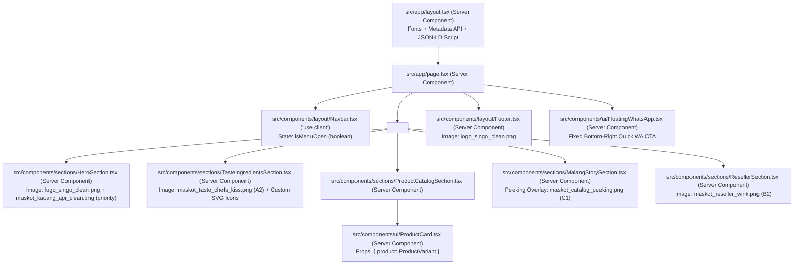
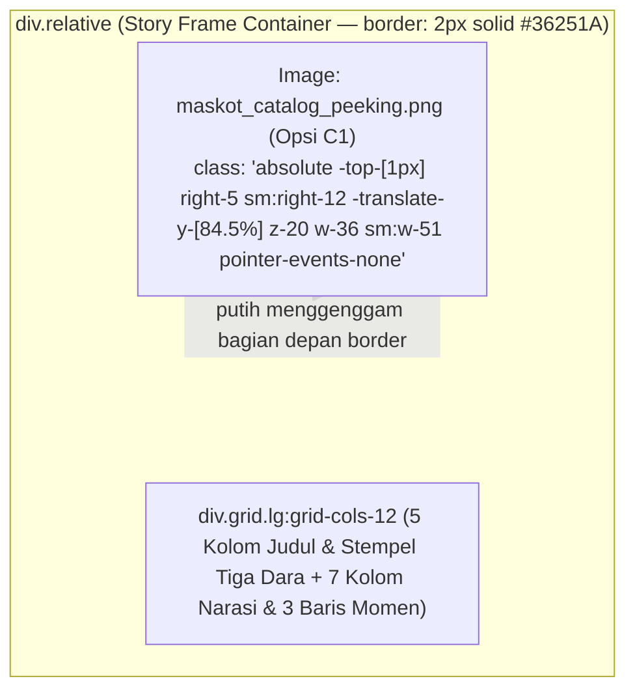

# Low-Level Design (LLD)
## Website Landing Page — Kacang Pedes Singo

| Informasi Dokumen | Detail |
| :--- | :--- |
| **Nama Proyek** | Website Landing Page Kacang Pedes Singo (MVP) |
| **Dokumen Referensi** | [brd_kacang_pedes_singo.md](file:///d:/Code/my-project/singo/docs/brd_kacang_pedes_singo.md) (v1.1) & [hld_kacang_pedes_singo.md](file:///d:/Code/my-project/singo/docs/hld_kacang_pedes_singo.md) (v1.1) |
| **Jenis Dokumen** | Low-Level Design (LLD) — Spesifikasi Implementasi Komponen & Kode (*Micro How*) |
| **Tech Stack** | **Next.js 16 (App Router)**, React 19, TypeScript 5, Tailwind CSS 4, Lucide React |
| **Versi & Status** | v1.0 — Ready for Implementation |
| **Tanggal** | 8 November 2026 |

---

## 1. Spesifikasi Proyek, Dependencies, & Pemetaan File Aset

### 1.1 Spesifikasi `package.json` & Dependencies
Proyek diinisialisasi menggunakan **Next.js 16 App Router** dengan dependensi minimal agar ukuran bundel JavaScript tetap ultra-ringan:

```json
{
  "name": "kacang-pedes-singo",
  "version": "1.0.0",
  "private": true,
  "scripts": {
    "dev": "next dev --turbopack",
    "build": "next build",
    "start": "next start",
    "lint": "next lint"
  },
  "dependencies": {
    "lucide-react": "^1.0.0",
    "next": "^16.0.0",
    "react": "^19.0.0",
    "react-dom": "^19.0.0"
  },
  "devDependencies": {
    "@tailwindcss/postcss": "^4.0.0",
    "@types/node": "^22.0.0",
    "@types/react": "^19.0.0",
    "@types/react-dom": "^19.0.0",
    "tailwindcss": "^4.0.0",
    "typescript": "^5.7.0"
  }
}
```

### 1.2 Konfigurasi `next.config.ts`
```typescript
import type { NextConfig } from 'next';

const nextConfig: NextConfig = {
  reactStrictMode: true,
  images: {
    formats: ['image/avif', 'image/webp'],
  },
};

export default nextConfig;
```

### 1.3 Tabel Pemetaan File Aset (`reference/web_assets/` $\rightarrow$ `public/images/`)
Saat inisialisasi proyek Next.js, ke-11 file di `reference/web_assets/` disalin ke direktori `public/images/` dengan struktur berikut:

| File Sumber (`reference/web_assets/`) | Path Target di Next.js (`public/`) | Dimensi Asli (px) | Rasio | Komponen Pemakai |
| :--- | :--- | :--- | :--- | :--- |
| `logo_singo_clean.png` | `/images/brand/logo_singo_clean.png` | `1986 x 995` | `~2:1` | `Navbar.tsx`, `HeroSection.tsx`, `Footer.tsx` |
| `maskot_kacang_api_clean.png` | `/images/brand/maskot_kacang_api_clean.png` | `1680 x 1562` | `~1:1` | `HeroSection.tsx` |
| `maskot_kacang_hot_clean.png` | `/images/brand/maskot_kacang_hot_clean.png` | `1641 x 1562` | `~1:1` | Cadangan / OG Image |
| `maskot_kacang_clean.png` | `/images/brand/maskot_kacang_clean.png` | `1641 x 1519` | `~1:1` | Favicon / Cadangan |
| `maskot_taste_chefs_kiss.png` | `/images/brand/maskot_taste_chefs_kiss.png` | `810 x 911` | `~8:9` | `TasteIngredientsSection.tsx` |
| `maskot_catalog_peeking.png` | `/images/brand/maskot_catalog_peeking.png` | `886 x 781` | `~9:8` | `MalangStorySection.tsx` (Peeking di atas bingkai cerita) |
| `maskot_reseller_wink.png` | `/images/brand/maskot_reseller_wink.png` | `820 x 907` | `~9:10` | `ResellerSection.tsx` |
| `placeholder_pack_kecil_10.png` | `/images/products/placeholder_pack_kecil_10.png` | `800 x 800` | `1:1` | `ProductCard.tsx` (`SKU-01`) |
| `placeholder_pack_sedang_5.png` | `/images/products/placeholder_pack_sedang_5.png` | `800 x 800` | `1:1` | `ProductCard.tsx` (`SKU-02`) |
| `placeholder_pack_sedang_10.png` | `/images/products/placeholder_pack_sedang_10.png` | `800 x 800` | `1:1` | `ProductCard.tsx` (`SKU-03`) |
| `placeholder_jumbo_115g.png` | `/images/products/placeholder_jumbo_115g.png` | `800 x 800` | `1:1` | `ProductCard.tsx` (`SKU-04`) |

---

## 2. Kontrak Data TypeScript, Konfigurasi Terpusat, & Fungsi Utilitas

### 2.1 Definisi Tipe Data (`src/types/index.ts`)
```typescript
export type CapType = 'cap_kecil' | 'cap_besar';

export type SkuCode = 'SKU-01' | 'SKU-02' | 'SKU-03' | 'SKU-04';

export interface ProductVariant {
  id: string;
  sku: SkuCode;
  name: string;
  shortName: string;
  packCount: string;
  netWeightGrams: number;
  priceIDR: number;
  capType: CapType;
  capLabel: string;
  image: string;
  imageAlt: string;
  isPlaceholder: boolean;
  isFeatured?: boolean; // Menandai kartu produk paling laris (highlight border & shadow)
  badge: string;
  segmentTag: string;
  description: string;
  waMessageTemplate: string;
}

export interface TastePillar {
  id: string;
  iconName: 'Flame' | 'Sparkles' | 'ShieldCheck';
  title: string;
  subtitle: string;
  description: string;
}

export type IngredientIconId = 'peanut' | 'chili' | 'sugar' | 'tamarind' | 'salt';

export interface IngredientItem {
  name: string;
  role: string;
  iconId: IngredientIconId; // Menggunakan Custom Vector SVG (0% emoji OS)
}

export interface ResellerBenefit {
  title: string;
  description: string;
}

export interface NavItem {
  label: string;
  href: string;
}
```

### 2.2 Konfigurasi Terpusat (`src/config/site.ts`)
Seluruh informasi bisnis, kontak WhatsApp, link Shopee, dan nomor legalitas dipusatkan di `src/config/site.ts` agar perubahan di kemudian hari tidak perlu menyentuh kode komponen UI:

```typescript
export const siteConfig = {
  brandName: 'Kacang Pedes Singo',
  tagline: 'Renyah Kacangnya, Pedasnya Bikin Kangen!',
  subTagline:
    'Kacang tanah goreng renyah dengan bumbu cabai, gula, dan asam jawa yang medok. Camilan pas buat teman santai, kerja, atau ngumpul bareng keluarga.',
  domainUrl: 'https://kacangpedessingo.com', // Placeholder domain terpusat
  legal: {
    pirtNumber: '2113514011294-28',
    halalNumber: 'ID35110014460411223',
    producerName: 'Tiga Dara',
    producerLocation: 'Purwodadi, Jawa Timur',
    originAssociation: 'Camilan Khas Malang',
  },
  contact: {
    whatsappNumber: '6281234567890', // Nomor WA terpusat (format internasional tanpa '+')
    whatsappDisplay: '0812-3456-7890',
    shopeeUrl: 'https://shopee.co.id/kacangpedessingo', // Link toko Shopee terpusat
    instagramUrl: 'https://instagram.com/kacangpedessingo',
    serviceArea: 'Lawang, Kota & Kabupaten Malang, Sidoarjo, hingga pengiriman seluruh Indonesia via Shopee',
  },
  waTemplates: {
    generalInquiry:
      'Halo Admin Kacang Pedes Singo, saya lihat dari website dan mau tanya info pemesanan produknya.',
    resellerInquiry:
      'Halo Admin Kacang Pedes Singo, saya tertarik ikut jualan / jadi Reseller di kota [Nama Kota]. Boleh minta info harga grosir dan minimal pembeliannya? Terima kasih!',
  },
} as const;
```

### 2.3 Data Statis Katalog & Konten (`src/data/products.ts`)
```typescript
import { ProductVariant, TastePillar, IngredientItem, ResellerBenefit } from '@/types';

export const PRODUCT_VARIANTS: ProductVariant[] = [
  {
    id: 'pack-kecil-10',
    sku: 'SKU-01',
    name: 'Pack Kecil (Isi 10 Bungkus)',
    shortName: 'Pack Kecil Isi 10',
    packCount: '10 bungkus kecil / pack',
    netWeightGrams: 120,
    priceIDR: 10000,
    capType: 'cap_kecil',
    capLabel: 'Cap Kecil (Horizontal)',
    image: '/images/products/placeholder_pack_kecil_10.png',
    imageAlt: 'Kacang Pedes Singo Khas Malang - Pack Kecil Isi 10 Bungkus (120 gram)',
    isPlaceholder: true,
    isFeatured: false,
    badge: 'Cocok buat Eceran Warung',
    segmentTag: 'Reseller & Camilan Saku',
    description:
      'Satu pack isi 10 bungkus kecil. Praktis buat bekal, dibagi-bagi ke teman, atau dijual eceran per bungkus di warung.',
    waMessageTemplate:
      'Halo Admin Kacang Pedes Singo, saya mau pesan *Pack Kecil (Isi 10 - 120gr)* harga Rp 10.000 sebanyak [... pack]. Mohon info total & ongkir ke [Kecamatan/Kota].',
  },
  {
    id: 'pack-sedang-5',
    sku: 'SKU-02',
    name: 'Pack Sedang (Isi 5 Bungkus)',
    shortName: 'Pack Sedang Isi 5',
    packCount: '5 bungkus sedang / pack',
    netWeightGrams: 120,
    priceIDR: 10000,
    capType: 'cap_kecil',
    capLabel: 'Cap Kecil (Horizontal)',
    image: '/images/products/placeholder_pack_sedang_5.png',
    imageAlt: 'Kacang Pedes Singo Khas Malang - Pack Sedang Isi 5 Bungkus (120 gram)',
    isPlaceholder: true,
    isFeatured: false,
    badge: 'Pas Buat Stok Harian',
    segmentTag: 'Ngemil Harian & Reseller',
    description:
      'Isi 5 bungkus ukuran sedang dengan porsi lebih puas per bungkusnya. Enak buat stok camilan di rumah atau meja kerja.',
    waMessageTemplate:
      'Halo Admin Kacang Pedes Singo, saya mau pesan *Pack Sedang (Isi 5 - 120gr)* harga Rp 10.000 sebanyak [... pack]. Mohon info total & ongkir ke [Kecamatan/Kota].',
  },
  {
    id: 'pack-sedang-10',
    sku: 'SKU-03',
    name: 'Pack Sedang (Isi 10 Bungkus)',
    shortName: 'Pack Sedang Isi 10',
    packCount: '10 bungkus sedang / pack',
    netWeightGrams: 240,
    priceIDR: 20000,
    capType: 'cap_kecil',
    capLabel: 'Cap Kecil (Horizontal)',
    image: '/images/products/placeholder_pack_sedang_10.png',
    imageAlt: 'Kacang Pedes Singo Khas Malang - Pack Sedang Isi 10 Bungkus (240 gram)',
    isPlaceholder: true,
    isFeatured: true, // Kartu unggulan Paling Laris (dengan highlight border & offset shadow)
    badge: 'Paling Laris',
    segmentTag: 'Keluarga, Oleh-oleh & Reseller',
    description:
      'Isi 10 bungkus ukuran sedang (total 240 gram). Pilihan paling pas buat suguhan tamu, kumpul keluarga, atau oleh-oleh.',
    waMessageTemplate:
      'Halo Admin Kacang Pedes Singo, saya mau pesan *Pack Sedang (Isi 10 - 240gr)* harga Rp 20.000 sebanyak [... pack]. Mohon info total & ongkir ke [Kecamatan/Kota].',
  },
  {
    id: 'jumbo-115g',
    sku: 'SKU-04',
    name: 'Kemasan Jumbo',
    shortName: 'Jumbo 115g',
    packCount: '1 bungkus besar utuh',
    netWeightGrams: 115,
    priceIDR: 10000,
    capType: 'cap_besar',
    capLabel: 'Cap Besar (Vertikal)',
    image: '/images/products/placeholder_jumbo_115g.png',
    imageAlt: 'Kacang Pedes Singo Khas Malang - Kemasan Jumbo 115 gram',
    isPlaceholder: true,
    isFeatured: false,
    badge: 'Praktis Sekali Buka',
    segmentTag: 'Ngemil Sendiri & Toples Rumah',
    description:
      'Satu bungkus besar 115 gram. Tinggal buka buat teman nonton atau langsung dituang ke toples camilan di rumah.',
    waMessageTemplate:
      'Halo Admin Kacang Pedes Singo, saya mau pesan *Kemasan Jumbo (115gr)* harga Rp 10.000 sebanyak [... bungkus]. Mohon info total & ongkir ke [Kecamatan/Kota].',
  },
];

export const TASTE_PILLARS: TastePillar[] = [
  {
    id: 'spicy-hot',
    iconName: 'Flame',
    title: 'Pedasnya Berasa Banget',
    subtitle: 'Cabai Merah Asli',
    description:
      'Pakai cabai merah asli yang pedasnya langsung terasa di lidah, bikin melek dan pengen nambah terus.',
  },
  {
    id: 'sweet-sour-savory',
    iconName: 'Sparkles',
    title: 'Bumbu Manis-Asam yang Medok',
    subtitle: 'Gula & Asam Jawa Pas',
    description:
      'Takaran gula dan asam jawanya pas, menyatu jadi bumbu karamel yang lengket, gurih, dan segar.',
  },
  {
    id: 'crunchy-no-preservatives',
    iconName: 'ShieldCheck',
    title: 'Kacangnya Garing & Tanpa Pengawet',
    subtitle: 'Renyah Sampai ke Dalam',
    description:
      'Digoreng sampai renyah ke dalam, nggak bau tengik, dan awet garingnya meski tanpa bahan pengawet.',
  },
];

export const NATURAL_INGREDIENTS: IngredientItem[] = [
  { name: 'Kacang Tanah', role: 'Kacang pilihan digoreng garing', iconId: 'peanut' },
  { name: 'Cabai', role: 'Pedas cabai merah asli', iconId: 'chili' },
  { name: 'Gula', role: 'Manis karamel yang pas', iconId: 'sugar' },
  { name: 'Asam Jawa', role: 'Segar asam yang khas', iconId: 'tamarind' },
  { name: 'Garam', role: 'Gurih pengikat rasa', iconId: 'salt' },
];

export const RESELLER_BENEFITS: ResellerBenefit[] = [
  {
    title: 'Harga Jual Terjangkau',
    description:
      'Harga eceran Rp 10.000 sampai Rp 20.000 bikin pembeli nggak mikir panjang buat beli.',
  },
  {
    title: 'Kemasan Siap Pajang',
    description:
      'Tersedia kemasan pack isi 5 dan isi 10 yang rapi, tinggal taruh di meja atau etalase.',
  },
  {
    title: 'Harga Khusus Grosir',
    description:
      'Ada harga khusus buat reseller dengan minimal pembelian yang ringan buat pemula.',
  },
  {
    title: 'Izin Kemasan Lengkap',
    description:
      'Sudah ada nomor P-IRT dan logo Halal resmi di kemasan, jadi aman dititipkan di toko mana pun.',
  },
];
```

### 2.4 Fungsi Helper Pembentuk URL & Formatter (`src/lib/utils.ts`)
```typescript
import { siteConfig } from '@/config/site';
import { ProductVariant } from '@/types';

export function buildWhatsAppUrl(message: string): string {
  const encodedMessage = encodeURIComponent(message);
  return `https://wa.me/${siteConfig.contact.whatsappNumber}?text=${encodedMessage}`;
}

export function getProductWhatsAppUrl(product: ProductVariant): string {
  return buildWhatsAppUrl(product.waMessageTemplate);
}

export function getResellerWhatsAppUrl(): string {
  return buildWhatsAppUrl(siteConfig.waTemplates.resellerInquiry);
}

export function getGeneralWhatsAppUrl(): string {
  return buildWhatsAppUrl(siteConfig.waTemplates.generalInquiry);
}

export function formatRupiah(amount: number): string {
  return new Intl.NumberFormat('id-ID', {
    style: 'currency',
    currency: 'IDR',
    minimumFractionDigits: 0,
    maximumFractionDigits: 0,
  }).format(amount);
}
```

---

## 3. Spesifikasi Tipografi & Design Tokens (`src/app/layout.tsx` & `src/app/globals.css`)

### 3.1 Konfigurasi Font (`src/app/layout.tsx`)
Menggunakan `next/font/google` dengan `display: 'swap'` agar teks langsung tampil tanpa memblokir rendering (*zero FOIT*):

```typescript
import { Bricolage_Grotesque, Plus_Jakarta_Sans } from 'next/font/google';

const fontDisplay = Bricolage_Grotesque({
  subsets: ['latin'],
  weight: ['700', '800'],
  variable: '--font-display',
  display: 'swap',
});

const fontSans = Plus_Jakarta_Sans({
  subsets: ['latin'],
  weight: ['400', '500', '600', '700'],
  variable: '--font-sans',
  display: 'swap',
});
```

### 3.2 Konfigurasi Variabel CSS & Tailwind Theme (`src/app/globals.css`)
```css
@import "tailwindcss";

:root {
  --bg-warm-cream: #FDF9F3;
  --bg-warm-sand: #F5ECE0;
  --surface-card: #FFFFFF;
  --primary-terracotta: #B84227;
  --primary-terracotta-hover: #9E361E;
  --accent-amber: #D67D28;
  --accent-amber-hover: #BD6C1F;
  --brand-green: #1F5F3A;
  --brand-green-hover: #17492C;
  --text-espresso: #36251A;
  --text-muted: #7A695E;
  --border-warm: #EADBCC;
}

@theme inline {
  --font-display: var(--font-display), sans-serif;
  --font-sans: var(--font-sans), sans-serif;
  --color-warm-cream: var(--bg-warm-cream);
  --color-warm-sand: var(--bg-warm-sand);
  --color-surface-card: var(--surface-card);
  --color-terracotta: var(--primary-terracotta);
  --color-terracotta-hover: var(--primary-terracotta-hover);
  --color-amber: var(--accent-amber);
  --color-amber-hover: var(--accent-amber-hover);
  --color-brand-green: var(--brand-green);
  --color-brand-green-hover: var(--brand-green-hover);
  --color-espresso: var(--text-espresso);
  --color-muted: var(--text-muted);
  --color-border-warm: var(--border-warm);
}

html {
  scroll-behavior: smooth;
  background-color: var(--bg-warm-cream);
  color: var(--text-espresso);
}
```

---

## 4. Arsitektur Pohon Komponen & Batas Server/Client

Hampir seluruh halaman dirender sebagai **React Server Components (RSC)** untuk menghasilkan HTML statis murni yang sangat cepat dan optimal untuk SEO. Hanya `Navbar.tsx` yang menggunakan `"use client"` untuk mengelola *state* buka/tutup menu *drawer* pada layar HP:



---

## 5. Spesifikasi Mikro Tiap Komponen UI (DOM, Props, & Tailwind Classes)

### 5.1 `src/components/layout/Navbar.tsx` (`"use client"`)
* **State Internal:** `const [isMobileMenuOpen, setIsMobileMenuOpen] = useState(false);`
* **Container Classes:** `sticky top-0 z-40 w-full bg-warm-cream/90 backdrop-blur-md border-b border-border-warm`
* **Inner Wrapper:** `max-w-6xl mx-auto px-4 sm:px-6 h-18 flex items-center justify-between`
* **Elemen Kiri (Brand Logo):**
  - `<a href="#top" className="flex items-center gap-2.5">`
  - `<Image src="/images/brand/logo_singo_clean.png" alt="Logo Kacang Pedes Singo" width={120} height={60} className="h-11 w-auto object-contain" priority />`
* **Elemen Tengah (Nav Links - Desktop `hidden md:flex items-center gap-7 text-sm font-semibold text-espresso`):**
  1. `Keunggulan` (`href="#keunggulan"`)
  2. `Varian & Harga` (`href="#katalog"`)
  3. `Cerita Kami` (`href="#cerita"`)
  4. `Peluang Reseller` (`href="#reseller"`)
* **Elemen Kanan (CTA Button):**
  - `<a href="#katalog" className="bg-terracotta hover:bg-terracotta-hover text-white text-sm font-semibold px-4 py-2.5 rounded-xl transition shadow-xs">Pesan Sekarang</a>`

---

### 5.2 `src/components/sections/HeroSection.tsx` (Server Component)
* **Section ID & Classes:** `id="top"`, `relative overflow-hidden py-12 sm:py-16 lg:py-20 px-4 sm:px-6 border-b-[1.5px] border-espresso`
* **Grid Container:** `max-w-6xl mx-auto grid grid-cols-1 lg:grid-cols-12 gap-10 lg:gap-12 items-center`
* **Kolom Kiri (`lg:col-span-7 space-y-6 text-left`):**
  - **Top Origin Ribbon Badge (Dengan Ikon SVG Cabai, Tanpa Emoji OS):**
    `inline-flex items-center gap-2 px-3.5 py-1.5 rounded-md bg-warm-sand border-[1.5px] border-espresso text-espresso text-xs sm:text-sm font-bold shadow-[2px_2px_0_#36251A]`
    Teks: `Camilan Khas Malang`
  - **H1 Headline (Satu Warna Tinta Menyatu + Garis Sapuan Kuas SVG Terracotta):**
    `font-display text-4xl sm:text-5xl lg:text-[3.5rem] font-extrabold text-espresso leading-[1.06] tracking-tight`
    Teks: `Renyah Kacangnya, Pedasnya Bikin Kangen!`
  - **Sub-headline Paragraph:**
    `text-base sm:text-lg text-muted max-w-[54ch] leading-relaxed`
    Teks: `Kacang tanah goreng renyah dengan bumbu cabai, gula, dan asam jawa yang medok. Camilan pas buat teman santai, kerja, atau ngumpul bareng keluarga.`
  - **Architectural Spec Ledger (3 Sel Bergaris Tinta dengan Ikon Vektor SVG):**
    `Pedas Mantap` | `5 Bahan Alami` | `Mulai Rp 10.000`
  - **CTA Group (`flex flex-wrap items-center gap-3.5 pt-2`):**
    1. **Primary CTA:** `<a href="#katalog" className="inline-flex items-center justify-center gap-2 bg-terracotta hover:bg-terracotta-hover text-white font-bold px-6 py-3.5 rounded-lg border-[1.5px] border-espresso shadow-[3px_3px_0_#36251A] transition">Lihat Pilihan Kemasan</a>`
    2. **Secondary CTA:** `<a href="#reseller" className="inline-flex items-center justify-center gap-2 bg-white hover:bg-warm-sand text-espresso border-[1.5px] border-espresso font-bold px-6 py-3.5 rounded-lg shadow-[3px_3px_0_#DECBB6] transition">Info Reseller</a>`
* **Kolom Kanan (`lg:col-span-5` — Authentic Malang Packaging Stage):**
  - Bingkai poster kemasan bergaya cap asli (`border-2 border-espresso rounded-2xl p-6 shadow-[6px_6px_0_#36251A]` dengan gradasi kuning-emas hangat).
  - Menampilkan **Logo Asli** `<Image src="/images/brand/logo_singo_clean.png" alt="Logo Singo Kacang Pedes Asli" width={220} height={110} priority />` tepat di atas **Maskot Utama** `<Image src="/images/brand/maskot_kacang_api_clean.png" alt="Maskot Kacang Pedes Singo Hot" width={265} height={246} priority />`, ditutup dengan pita stempel komposisi & harga `Rp 10.000` di bagian bawah.

---

### 5.3 `src/components/sections/TasteIngredientsSection.tsx` (Server Component)
* **Section ID & Classes:** `id="keunggulan"`, `py-16 sm:py-20 px-4 sm:px-6 bg-warm-sand border-b-[1.5px] border-espresso`
* **Layout Struktur (*Architectural Packaging Ledger*):**
  1. **Header Row 2 Kolom (`border-b-[1.5px] border-espresso pb-8`):** Judul H2 (`Kenapa Kacang Pedes Singo Banyak yang Suka?`) di kiri + subjudul (`Karena racikan bumbunya nggak pelit dan murni pakai bahan dapur sehari-hari.`) di kanan.
  2. **3 Kolom Karakter Rasa Bergaris Tinta (`grid grid-cols-1 md:grid-cols-3 bg-warm-cream border-x-[1.5px] border-b-[1.5px] border-espresso`):**
     Me-render `TASTE_PILLARS` dengan ikon vektor SVG kustom (Cabai, Tetes Karamel Asam-Manis, Perisai Keroyokan Renyah) dan garis pemisah antar-kolom `border-r-[1.5px] border-espresso`.
  3. **Blok Komposisi 5 Bahan Dapur Asli + Maskot `A2` (`bg-white border-x-[1.5px] border-b-[1.5px] border-espresso grid grid-cols-1 lg:grid-cols-12`):**
     - **Kiri (`lg:col-span-4 bg-[#FBF2E3] border-b-[1.5px] lg:border-b-0 lg:border-r-[1.5px] border-espresso p-7 flex items-center justify-center`):**
       Menampilkan **Maskot Pilihan A2** (`<Image src="/images/brand/maskot_taste_chefs_kiss.png" alt="Maskot Kacang Pedes Singo Chef Kiss" width={195} height={220} className="w-48 h-auto object-contain" />`).
     - **Kanan (`lg:col-span-8 p-7 sm:p-9`):**
       Judul H3: `"Cuma Pakai 5 Bahan Dapur Asli"` + sub-deskripsi, diikuti tabel 5 kolom (`NATURAL_INGREDIENTS`) yang masing-masing dilengkapi **Ilustrasi Vektor SVG Kustom** (Kacang Tanah, Cabai, Gula, Asam Jawa, Garam).

---

### 5.4 `src/components/sections/ProductCatalogSection.tsx` & `src/components/ui/ProductCard.tsx`
* **Section ID:** `id="katalog"`, `py-16 sm:py-22 px-4 sm:px-6 border-b-[1.5px] border-espresso`
* **Grid Katalog (Bersih 2x2 Tanpa Tertutupi Maskot):** `max-w-6xl mx-auto grid grid-cols-1 md:grid-cols-2 gap-8 mb-9`

* **Kode Struktur `ProductCard.tsx`:**
```tsx
export function ProductCard({ product }: { product: ProductVariant }) {
  const waUrl = getProductWhatsAppUrl(product);

  return (
    <article
      className={`relative z-10 h-full flex flex-col justify-between bg-white rounded-2xl p-6 transition ${
        product.isFeatured
          ? 'border-2 border-espresso shadow-[6px_6px_0_#D67D28] bg-[#FFFDF8]'
          : 'border-[1.5px] border-espresso shadow-[4px_4px_0_#36251A]'
      }`}
    >
      <div>
        <div className="relative aspect-[4/3] w-full rounded-xl overflow-hidden bg-warm-cream border-[1.5px] border-border-warm mb-5 p-3">
          <Image
            src={product.image}
            alt={product.imageAlt}
            fill
            sizes="(max-width: 768px) 100vw, 50vw"
            className="object-contain p-2"
          />
        </div>

        <span
          className={`inline-block text-xs font-bold px-2.5 py-1 rounded-md border border-espresso mb-2.5 ${
            product.isFeatured ? 'bg-[#F9E398] text-espresso' : 'bg-warm-sand text-espresso'
          }`}
        >
          {product.badge}
        </span>

        <div className="flex items-start justify-between gap-4 mb-3">
          <h3 className="font-display text-2xl font-extrabold text-espresso leading-tight">
            {product.name}
          </h3>
          <div className="text-right shrink-0">
            <span className="text-[11px] font-semibold text-muted block">Harga Eceran</span>
            <span className="font-display text-2xl font-extrabold text-terracotta">
              {formatRupiah(product.priceIDR)}
            </span>
          </div>
        </div>

        <p className="text-sm text-muted leading-relaxed mb-4">
          {product.description}
        </p>
      </div>

      <div>
        {/* Tabel Spesifikasi Fisik Kemasan */}
        <div className="grid grid-cols-2 gap-3 py-2.5 mb-4 border-y border-border-warm text-xs">
          <div>
            <span className="block text-[11px] text-muted">Isi Kemasan</span>
            <strong className="font-bold text-espresso">{product.packCount}</strong>
          </div>
          <div>
            <span className="block text-[11px] text-muted">Berat Bersih</span>
            <strong className="font-bold text-espresso">{product.netWeightGrams} gram</strong>
          </div>
        </div>

        {/* Dual CTA Buttons: WhatsApp & Shopee (dengan Ikon SVG) */}
        <div className="grid grid-cols-1 sm:grid-cols-2 gap-2.5">
          <a
            href={waUrl}
            target="_blank"
            rel="noopener noreferrer"
            className="inline-flex items-center justify-center gap-2 bg-brand-green hover:bg-brand-green-hover text-white text-xs sm:text-sm font-bold py-3 px-4 rounded-lg border-[1.5px] border-espresso transition"
          >
            Pesan lewat WhatsApp
          </a>
          <a
            href={siteConfig.contact.shopeeUrl}
            target="_blank"
            rel="noopener noreferrer"
            className="inline-flex items-center justify-center gap-2 bg-amber hover:bg-amber-hover text-white text-xs sm:text-sm font-bold py-3 px-4 rounded-lg border-[1.5px] border-espresso transition"
          >
            Beli di Shopee
          </a>
        </div>
      </div>
    </article>
  );
}
```

* **Banner Catatan Info Ongkir & Marketplace (di bawah grid 4 kartu, memenuhi `BR-03`):**
  Kotak informasi (`bg-warm-sand border-[1.5px] border-espresso rounded-xl p-4 sm:p-5 flex items-center gap-4 text-xs sm:text-sm text-espresso`) lengkap dengan ikon vektor truk pengiriman.

---

### 5.5 `src/components/sections/MalangStorySection.tsx` (Server Component — Dengan Maskot Peeking `Opsi C1`)
* **Section ID & Classes:** `id="cerita"`, `pt-32 sm:pt-38 pb-20 px-4 sm:px-6 bg-warm-cream border-b-[1.5px] border-espresso`
* **Mekanisme Presisi Sub-Piksel Maskot Pengintip (`Opsi C1` — `maskot_catalog_peeking.png`):**
  Berdasarkan dimensi asli `maskot_catalog_peeking.png` (`886 x 781px`), garis potong horizontal badan kacang berada tepat pada `84.5%` tinggi gambar dari atas, sedangkan `15.5%` sisanya di bagian bawah adalah jari-jari sarung tangan putih yang menjuntai.
  Dengan menempatkan gambar menggunakan `position: absolute; top: -1px; right: 48px; transform: translateY(-84.5%);`, bagian bawah badan kacang menapak **100% rata** di atas garis `border-top` bingkai cerita pada ukuran layar berapa pun, sementara kedua sarung tangan putihnya menjuntai ke depan menggenggam tepi bingkai:



---

### 5.6 `src/components/sections/ResellerSection.tsx` (Server Component)
* **Section ID:** `id="reseller"`, `py-16 sm:py-22 px-4 sm:px-6 bg-warm-sand`
* **Container Sheet:** `max-w-6xl mx-auto bg-white border-2 border-espresso rounded-2xl shadow-[6px_6px_0_#36251A] overflow-hidden grid grid-cols-1 lg:grid-cols-12`
* **Kolom Kiri (`lg:col-span-7 p-6 sm:p-12 border-b-[1.5px] lg:border-b-0 lg:border-r-[1.5px] border-espresso`):**
  - Tag: `Kemitraan Warung & Reseller`
  - Judul H2: `"Mau Ikut Jualan Kacang Pedes Singo?"`
  - Sub-deskripsi: `"Camilan harga Rp 10.000-an itu paling cepat perputarannya. Pas banget buat tambahan barang di warung, kantin, toko oleh-oleh, atau dijual ke teman-teman."` & Grid 2x2 `RESELLER_BENEFITS` bergaris tinta dengan ikon SVG.
  - Tombol CTA B2B: `<a href={getResellerWhatsAppUrl()} target="_blank" rel="noopener noreferrer" className="inline-flex items-center gap-2.5 bg-terracotta hover:bg-terracotta-hover text-white font-bold px-6 py-4 rounded-lg border-[1.5px] border-espresso shadow-[3px_3px_0_#36251A] transition">Tanya Harga Reseller lewat WhatsApp</a>`
* **Kolom Kanan (`lg:col-span-5 p-8 flex flex-col items-center justify-center text-center bg-warm-cream`):**
  - Menampilkan **Maskot Pilihan B2** (`<Image src="/images/brand/maskot_reseller_wink.png" alt="Maskot Mitra Reseller Kacang Pedes Singo" width={240} height={265} className="w-52 sm:w-60 h-auto object-contain drop-shadow-sm mb-4" />`).

---

### 5.7 `src/components/layout/Footer.tsx` & `src/components/ui/FloatingWhatsApp.tsx`

#### A. `Footer.tsx` (Server Component)
* Menampilkan `logo_singo_clean.png`, deskripsi singkat (`Camilan kacang tanah goreng bumbu pedas, asam, dan manis khas Malang.`), navigasi cepat, serta baris informasi legalitas yang rapi di bagian bawah:
  `Diproduksi oleh Tiga Dara, Purwodadi - Jawa Timur` bersama badge `P-IRT 2113514011294-28` dan `Halal Indonesia ID35110014460411223`.

#### B. `FloatingWhatsApp.tsx` (Server Component — Pojok Kanan Bawah Layar)
Tombol mengambang di pojok kanan bawah layar dengan ikon vektor WhatsApp dan bayangan tegas (`shadow-[3px_3px_0_#36251A]`) memberikan akses cepat ke WhatsApp kapan pun pengunjung menggulir halaman.

---

## 6. Spesifikasi Copywriting Final per Section (0% Emoji OS — 100% Custom SVG)

| Section | Elemen Teks | Copywriting Final |
| :--- | :--- | :--- |
| **1. Hero** | Label Atas (Ribbon Badge) | `Camilan Khas Malang` *(dengan ikon SVG cabai)* |
| **1. Hero** | Headline (H1) | `Renyah Kacangnya, Pedasnya Bikin Kangen!` |
| **1. Hero** | Sub-headline | `Kacang tanah goreng renyah dengan bumbu cabai, gula, dan asam jawa yang medok. Camilan pas buat teman santai, kerja, atau ngumpul bareng keluarga.` |
| **1. Hero** | 3 Sel Spec Ledger | `Pedas Mantap` \| `5 Bahan Alami` \| `Mulai Rp 10.000` *(masing-masing dengan ikon SVG)* |
| **1. Hero** | Tombol CTA | `Lihat Pilihan Kemasan` & `Info Reseller` |
| **2. Rasa & Bahan** | Judul Section (H2) | `Kenapa Kacang Pedes Singo Banyak yang Suka?` |
| **2. Rasa & Bahan** | Sub-judul | `Karena racikan bumbunya nggak pelit dan murni pakai bahan dapur sehari-hari.` |
| **2. Rasa & Bahan** | Kolom Rasa 1 | **Pedasnya Berasa Banget:** Pakai cabai merah asli yang pedasnya langsung terasa di lidah, bikin melek dan pengen nambah terus. |
| **2. Rasa & Bahan** | Kolom Rasa 2 | **Bumbu Manis-Asam yang Medok:** Takaran gula dan asam jawanya pas, menyatu jadi bumbu karamel yang lengket, gurih, dan segar. |
| **2. Rasa & Bahan** | Kolom Rasa 3 | **Kacangnya Garing & Tanpa Pengawet:** Digoreng sampai renyah ke dalam, nggak bau tengik, dan awet garingnya meski tanpa bahan pengawet. |
| **2. Rasa & Bahan** | Judul 5 Bahan | `Cuma Pakai 5 Bahan Dapur Asli` (`Kacang Tanah`, `Cabai`, `Gula`, `Asam Jawa`, `Garam` — dengan ilustrasi vektor SVG kustom) |
| **3. Katalog** | Judul Section (H2) | `Pilih Ukuran Kemasanmu` |
| **3. Katalog** | Sub-judul | `Mau buat ngemil sendiri, stok di rumah, oleh-oleh khas Malang, atau buat dijual lagi, semua mulai Rp 10.000.` |
| **3. Katalog** | Tombol Kartu | `Pesan lewat WhatsApp` & `Beli di Shopee` |
| **3. Katalog** | Info Pengiriman | `Info Pengiriman: Buat area Malang Raya, Lawang, Sidoarjo, dan sekitarnya bisa pesan langsung lewat WhatsApp. Kalau kamu di luar kota, bisa beli lewat Shopee supaya dapat Voucher Gratis Ongkir (harga di Shopee menyesuaikan biaya layanan aplikasi).` |
| **4. Cerita** | Judul Section (H2) | `Rasa Kacang Bumbu Khas Malang yang Selalu Dirindukan` *(ditemani Maskot Peeking C1 di tepi kanan atas bingkai)* |
| **4. Cerita** | Paragraf Narasi | `Kacang goreng berbumbu pedas, manis, dan asam sudah lama jadi camilan favorit di Malang dan sekitarnya. Rasanya yang khas bikin siapa saja yang pernah coba pasti kangen ingin ngemil lagi.`<br>`Di Kacang Pedes Singo, rasa khas itu terus kami jaga lewat olahan rumahan yang bersih dengan bumbu yang tetap medok. Cocok buat teman ngobrol, minum teh hangat, atau buah tangan buat keluarga di rumah.` |
| **5. Reseller** | Label & Judul (H2) | `Kemitraan Warung & Reseller` — `Mau Ikut Jualan Kacang Pedes Singo?` |
| **5. Reseller** | Sub-judul | `Camilan harga Rp 10.000-an itu paling cepat perputarannya. Pas banget buat tambahan barang di warung, kantin, toko oleh-oleh, atau dijual ke teman-teman.` |
| **5. Reseller** | Tombol CTA | `Tanya Harga Reseller lewat WhatsApp` |
| **6. Footer** | Baris Info Legalitas | `Diproduksi oleh Tiga Dara, Purwodadi - Jawa Timur` • `P-IRT 2113514011294-28` • `Halal Indonesia ID35110014460411223` |

---

## 7. Spesifikasi Low-Level SEO, Metadata API, & JSON-LD (Next.js 16)

### 7.1 Implementasi Metadata API (`src/app/layout.tsx`)
```typescript
import type { Metadata } from 'next';
import { siteConfig } from '@/config/site';

export const metadata: Metadata = {
  metadataBase: new URL(siteConfig.domainUrl),
  title: {
    default: `${siteConfig.brandName} — Camilan Kacang Pedas Asam Manis Khas Malang`,
    template: `%s | ${siteConfig.brandName}`,
  },
  description:
    'Kacang Pedes Singo khas Malang dengan perpaduan rasa pedas kuat (hot), asam jawa, dan manis gula asli. 100% bahan alami, berizin P-IRT & Halal Indonesia. Tersedia eceran Rp 10.000 & harga grosir reseller.',
  keywords: [
    'Kacang Pedes Singo',
    'kacang pedas khas Malang',
    'camilan khas Malang',
    'oleh-oleh khas Malang murah',
    'kacang bumbu pedas asam manis',
    'reseller snack Malang',
    'kacang pedas Tiga Dara Purwodadi',
  ],
  openGraph: {
    type: 'website',
    locale: 'id_ID',
    url: siteConfig.domainUrl,
    siteName: siteConfig.brandName,
    title: `${siteConfig.brandName} — Pedasnya Bikin Kangen!`,
    description:
      'Camilan kacang tanah goreng bumbu pedas-asam-manis khas Malang. Tersedia kemasan Rp 10.000 & peluang kemitraan reseller.',
    images: [
      {
        url: '/images/brand/maskot_kacang_api_clean.png',
        width: 1200,
        height: 630,
        alt: 'Kacang Pedes Singo - Camilan Khas Malang',
      },
    ],
  },
  robots: {
    index: true,
    follow: true,
  },
};
```

### 7.2 Implementasi JSON-LD Structured Data (`src/components/seo/JsonLd.tsx`)
Disematkan di dalam `src/app/page.tsx` agar mesin pencari Google membaca skema bisnis lokal beserta daftar ke-4 produk dan harganya (`AggregateOffer`):

```typescript
import { siteConfig } from '@/config/site';
import { PRODUCT_VARIANTS } from '@/data/products';

export function JsonLd() {
  const structuredData = {
    '@context': 'https://schema.org',
    '@graph': [
      {
        '@type': 'Organization',
        '@id': `${siteConfig.domainUrl}/#organization`,
        name: siteConfig.brandName,
        url: siteConfig.domainUrl,
        logo: `${siteConfig.domainUrl}/images/brand/logo_singo_clean.png`,
        description: siteConfig.subTagline,
        address: {
          '@type': 'PostalAddress',
          addressLocality: 'Purwodadi',
          addressRegion: 'Jawa Timur',
          addressCountry: 'ID',
        },
      },
      {
        '@type': 'Product',
        name: siteConfig.brandName,
        image: PRODUCT_VARIANTS.map((p) => `${siteConfig.domainUrl}${p.image}`),
        description:
          'Kacang tanah goreng berbalut bumbu pedas kuat, asam, dan manis khas Malang. Bersertifikat Halal Indonesia (ID35110014460411223) dan P-IRT (2113514011294-28).',
        brand: {
          '@type': 'Brand',
          name: siteConfig.brandName,
        },
        manufacturer: {
          '@type': 'Organization',
          name: siteConfig.legal.producerName,
        },
        offers: {
          '@type': 'AggregateOffer',
          priceCurrency: 'IDR',
          lowPrice: '10000',
          highPrice: '20000',
          offerCount: PRODUCT_VARIANTS.length,
          availability: 'https://schema.org/InStock',
        },
      },
    ],
  };

  return (
    <script
      type="application/ld+json"
      dangerouslySetInnerHTML={{ __html: JSON.stringify(structuredData) }}
    />
  );
}
```

### 7.3 Generator `sitemap.ts` & `robots.ts`
* **`src/app/sitemap.ts`:**
```typescript
import type { MetadataRoute } from 'next';
import { siteConfig } from '@/config/site';

export default function sitemap(): MetadataRoute.Sitemap {
  return [
    {
      url: siteConfig.domainUrl,
      lastModified: new Date(),
      changeFrequency: 'weekly',
      priority: 1.0,
    },
  ];
}
```

* **`src/app/robots.ts`:**
```typescript
import type { MetadataRoute } from 'next';
import { siteConfig } from '@/config/site';

export default function robots(): MetadataRoute.Robots {
  return {
    rules: {
      userAgent: '*',
      allow: '/',
    },
    sitemap: `${siteConfig.domainUrl}/sitemap.xml`,
  };
}
```

---

## 8. Matriks Verifikasi & Pengujian Teknis (QA Checklist)

| Kode Uji | Komponen yang Diuji | Skenario Verifikasi | Kriteria Lulus (Pass Criteria) |
| :--- | :--- | :--- | :--- |
| **QA-01** | Build Statis Next.js 16 | Menjalankan `npm run build` | Build selesai dengan *exit code 0*, halaman `/` ter-prerender sebagai konten statis (`○ Static`). |
| **QA-02** | Generator URL WA per SKU | Klik tombol *Pesan via WhatsApp* pada ke-4 kartu produk | URL mengarah ke `https://wa.me/...` dengan nama varian dan harga yang tepat sesuai SKU yang diklik. |
| **QA-03** | Generator URL WA Reseller | Klik tombol *Tanya Harga Khusus Reseller* di Section 5 | URL mengarah ke `https://wa.me/...` dengan template pesan kemitraan B2B. |
| **QA-04** | Positioning Maskot `C1` | Tinjau kartu `SKU-03 (Pack Sedang Isi 10)` di layar HP (`375px`) dan Desktop (`1280px`) | Gambar `maskot_catalog_peeking.png` menempel rapi di tepi kanan atas kartu tanpa menutupi teks nama/harga produk. |
| **QA-05** | Floating WhatsApp Button | Gulir halaman dari Hero hingga Footer di layar HP | Tombol `FloatingWhatsApp` tetap terlihat di pojok kanan bawah (`z-50`) dan tidak menutupi tombol CTA utama. |
| **QA-06** | Validasi SEO & JSON-LD | Periksa *Page Source* (`Ctrl+U`) pada halaman yang berjalan | Tag `<title>`, `<meta name="description">`, `og:image`, dan `<script type="application/ld+json">` ter-render di HTML awal. |
